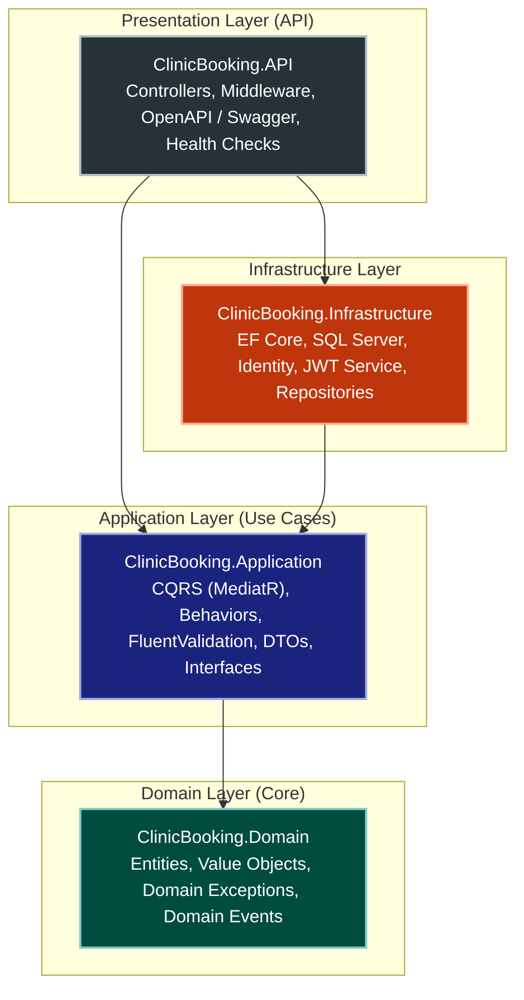
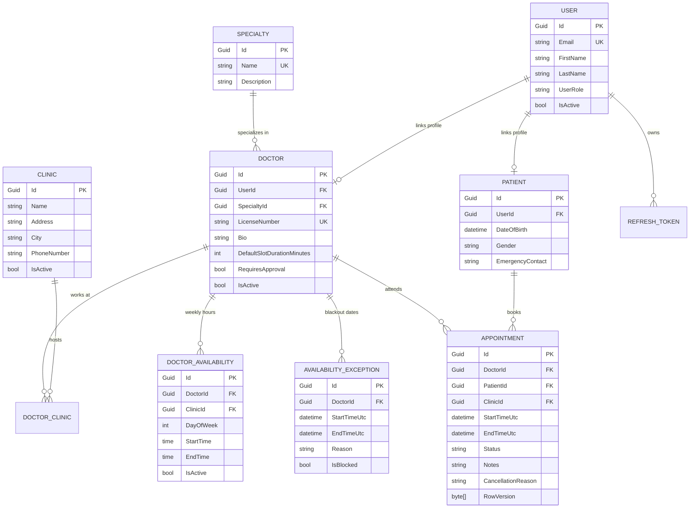
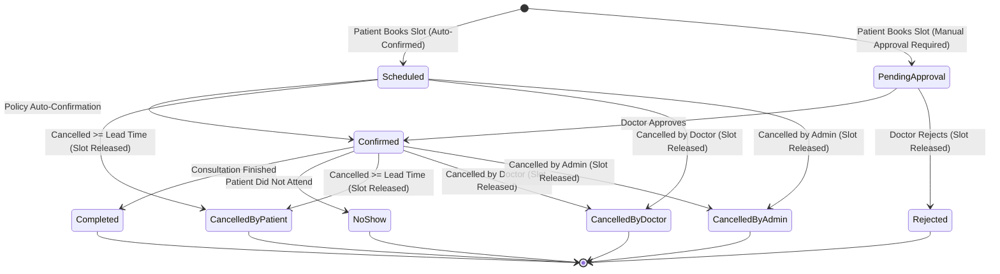

# Clinic Appointment Booking System
## ASP.NET Core Web API – Clean Architecture – .NET 10 – DDD – CI/CD

[](https://dotnet.microsoft.com/)
[](https://blog.cleancoder.com/uncle-bob/2012/08/13/the-clean-architecture.html)
[](https://github.com/jbogard/MediatR)
[](https://www.docker.com/)
[](LICENSE)

A production-ready Clinic Appointment Booking System engineered with modern .NET technologies, Clean Architecture, Domain-Driven Design (DDD) principles, CQRS with MediatR, ASP.NET Core Identity with JWT and refresh token rotation, strict double-booking concurrency protection, structured Serilog logging, and multi-stage Docker / GitHub Actions CI/CD automation.

---

## Table of Contents
1. [Project Overview](#project-overview)
2. [Architectural Blueprint](#architectural-blueprint)
3. [Technology Stack](#technology-stack)
4. [Solution & Project Structure](#solution--project-structure)
5. [Domain Model & Entity Relationships](#domain-model--entity-relationships)
6. [Appointment Booking & Concurrency Protection](#appointment-booking--concurrency-protection)
7. [Appointment Status Lifecycle](#appointment-status-lifecycle)
8. [API Design & Endpoints](#api-design--endpoints)
9. [Security Architecture](#security-architecture)
10. [Database Design & Indexing Strategy](#database-design--indexing-strategy)
11. [Testing Strategy](#testing-strategy)
12. [Docker & Containerization](#docker--containerization)
13. [CI/CD Pipeline (GitHub Actions & Azure)](#cicd-pipeline-github-actions--azure)
14. [Local Development Setup](#local-development-setup)
15. [Implementation Roadmap](#implementation-roadmap)

---

## 1. Project Overview

The Clinic Appointment Booking platform provides secure, fault-tolerant appointment scheduling connecting Patients, Doctors, and Clinic Administrators.

### Primary Actors & Capabilities

- **Patient**:
  - Register, authenticate, manage refresh tokens.
  - Discover doctors by specialty, clinic, and rating.
  - Query dynamically calculated available appointment slots.
  - Reserve slots with guaranteed protection against concurrent double-booking.
  - View upcoming and historical appointments.
  - Cancel appointments subject to clinic cancellation lead-time rules.
  - Monitor live appointment status (Scheduled, Confirmed, Completed, Cancelled).

- **Doctor**:
  - Access personal schedule and daily roster.
  - Configure recurring weekly availability (working days, shifts, clinic assignment).
  - Define custom slot durations (e.g., 15, 30, 45, 60 minutes).
  - Block blackout dates, holidays, and temporary exceptions.
  - Approve or reject booking requests when manual doctor confirmation is enabled.

- **Administrator**:
  - Manage clinics, specialties, doctors, and patient records.
  - Assign doctors to multiple clinical locations.
  - Establish clinic booking and cancellation policies.
  - View organization-wide appointments with admin override capability (reschedule, cancel).
  - Access dashboard analytics (occupancy rates, cancellation frequency, peak booking hours).

---

## 2. Architectural Blueprint

The system strictly adheres to **Clean Architecture** and **SOLID** principles, ensuring separation of concerns and independent testability.



### Architectural Dependency Rules

1. **Domain**: The core layer. Zero dependencies on external libraries or surrounding layers. Contains pure business logic, domain entities, value objects, domain events, and domain exceptions.
2. **Application**: Depends exclusively on Domain. Defines use cases via CQRS Commands and Queries, pipeline behaviors (validation, logging, transactions), and abstract contracts (`IAppointmentRepository`, `IClinicBookingDbContext`, `ITokenService`).
3. **Infrastructure**: Implements interfaces declared in Application or Domain. Encapsulates external concerns: EF Core, SQL Server database mappings, ASP.NET Core Identity, JWT generation and validation, external mail/SMS notifications.
4. **API**: Host application. Wires up Dependency Injection in `Program.cs`. Dispatches HTTP requests into Application use cases via MediatR. Contains zero domain logic or direct database queries.

---

## 3. Technology Stack

- **Framework**: .NET 10 (ASP.NET Core Web API)
- **Language**: C# 13
- **ORM**: Entity Framework Core 10
- **Database Engine**: Microsoft SQL Server
- **Architecture Pattern**: Clean Architecture + Domain-Driven Design (DDD)
- **Use Case Orchestration**: CQRS using MediatR
- **Request Validation**: FluentValidation
- **Authentication & Authorization**: ASP.NET Core Identity + JWT Bearer Tokens with Refresh Token Rotation
- **API Documentation**: Microsoft.AspNetCore.OpenApi / Swagger UI
- **Structured Logging**: Serilog with Console and File sinks
- **Testing Frameworks**: xUnit, FluentAssertions, Moq
- **Containerization**: Docker (multi-stage build), Docker Compose
- **Continuous Integration / Continuous Delivery**: GitHub Actions
- **Cloud Deployment**: Azure App Service (Docker container) & Azure SQL Database

---

## 4. Solution & Project Structure

```
ClinicBooking/
├── .github/
│   └── workflows/
│       ├── ci.yml                     # Continuous Integration workflow
│       └── cd.yml                     # Continuous Deployment workflow (GHCR & Azure)
├── docker/
│   ├── Dockerfile                     # Optimized multi-stage Docker build
│   └── docker-compose.yml             # Local composition of API & SQL Server
├── src/
│   ├── ClinicBooking.Domain/          # Core business entities & domain logic
│   │   ├── Common/                    # Entity, AggregateRoot, ValueObject base types
│   │   ├── Entities/                  # Appointment, Doctor, Patient, Clinic, etc.
│   │   ├── Enums/                     # AppointmentStatus, DayOfWeek, UserRole
│   │   ├── Events/                    # AppointmentBookedEvent, AppointmentCancelledEvent
│   │   ├── Exceptions/                # Domain-specific typed exceptions
│   │   └── ValueObjects/              # DateTimeRange, TimeSlot, PhoneNumber
│   │
│   ├── ClinicBooking.Application/     # Application use cases & interfaces
│   │   ├── Common/                    # Result, PagedList, Pipeline Behaviors
│   │   ├── Contracts/                 # Repository and Service interfaces
│   │   └── Features/                  # Vertical slices by business capability
│   │       ├── Appointments/          # Book, Cancel, Reschedule, GetSlots
│   │       ├── Authentication/        # Register, Login, RefreshToken, Revoke
│   │       ├── Doctors/               # Create, Update, Schedule, Availability
│   │       ├── Patients/              # Profiles, History
│   │       ├── Specialties/           # Catalog management
│   │       └── Clinics/               # Locations & Doctor assignments
│   │
│   ├── ClinicBooking.Infrastructure/  # External implementations & persistence
│   │   ├── Authentication/            # TokenService, PasswordHasher, JwtOptions
│   │   ├── Persistence/               # ClinicBookingDbContext, Migrations, Seeders
│   │   │   ├── Configurations/        # Fluent API entity & index configurations
│   │   │   └── Repositories/          # Concrete EF Core repositories
│   │   └── Services/                  # System clock, notification mocks
│   │
│   └── ClinicBooking.API/             # Web API entry point
│       ├── Controllers/               # v1 REST API Controllers
│       ├── Middleware/                # GlobalExceptionMiddleware, CorrelationIdMiddleware
│       ├── Extensions/                # ServiceCollection & WebApp configuration
│       └── Program.cs                 # ASP.NET Core host initialization
│
└── tests/
    ├── ClinicBooking.Domain.Tests/          # Unit tests for domain models & rules
    ├── ClinicBooking.Application.Tests/     # Unit tests for CQRS handlers & validators
    ├── ClinicBooking.Infrastructure.Tests/  # Integration tests for EF mappings & DbContext
    └── ClinicBooking.API.Tests/             # End-to-end integration & concurrency tests
```

---

## 5. Domain Model & Entity Relationships



### Core Business Invariants Enforced in Domain

1. **Doctor Non-Overlap**: A doctor cannot have overlapping active appointments.
2. **Patient Non-Overlap**: A patient cannot book overlapping active appointments across any doctor/clinic.
3. **Working Hours & Breaks**: Appointments must strictly align with doctor working hours and slot boundaries.
4. **Blackout Window Check**: Slots falling within an active `AvailabilityException` (e.g., vacation, sick leave) cannot be booked.
5. **Temporal Validity**: Appointments cannot be scheduled in the past.
6. **UTC Timestamps**: All temporal calculations and persistence use UTC format (`DateTimeKind.Utc`).
7. **Configurable Slot Durations**: Slot generation honors doctor-defined duration intervals (default 30 minutes).

---

## 6. Appointment Booking & Concurrency Protection

Preventing double bookings under concurrent user traffic is protected by a **4-Layer Defense-in-Depth Strategy**:

```mermaid
flowchart TD
    Req["Incoming Booking Request\n(PatientId, DoctorId, SlotUtc)"] --> L1

    subgraph L1["Layer 1: Domain & Application In-Memory Validation"]
        V1["Validate Slot Alignment & Duration"]
        V2["Validate Doctor Working Hours (DayOfWeek & TimeSpan)"]
        V3["Validate Blackout Exceptions (AvailabilityException)"]
        V4["Validate Active Appointments in Selected Window"]
    end

    L1 --> L2

    subgraph L2["Layer 2: Database Transaction & Locking"]
        TX["EF Core ExecutionStrategy (Handles transient retries)"]
        ISOLATION["Explicit DB Transaction with ReadCommitted / Serializable Isolation"]
    end

    L2 --> L3

    subgraph L3["Layer 3: SQL Server Filtered Unique Index (Absolute Guardrail)"]
        FUI_DOC["CREATE UNIQUE INDEX IX_Appointments_Doctor_Slot\nON Appointments(DoctorId, StartTimeUtc)\nWHERE Status NOT IN ('CancelledByPatient', 'CancelledByDoctor', 'CancelledByAdmin', 'Rejected')"]
        FUI_PAT["CREATE UNIQUE INDEX IX_Appointments_Patient_Slot\nON Appointments(PatientId, StartTimeUtc)\nWHERE Status NOT IN ('CancelledByPatient', 'CancelledByDoctor', 'CancelledByAdmin', 'Rejected')"]
    end

    L3 -->|Conflict Detected (SQL Error 2601 / 2627)| L4
    L3 -->|Success| Commit["201 Created (Appointment Details)"]

    subgraph L4["Layer 4: Exception Handling & API Translation"]
        EX_TRANS["Catch DbUpdateException -> Map to AppointmentSlotAlreadyBookedException"]
        STATUS_409["Return HTTP 409 Conflict with ProblemDetails payload"]
    end
```

### Why Filtered Unique Indexes Guarantee Consistency:
- Even if two concurrent requests evaluate availability at the exact same millisecond and pass application checks simultaneously, the SQL Server database engine rejects the duplicate insert.
- When an appointment is cancelled, its status updates to `CancelledByPatient` (or `CancelledByDoctor`/`CancelledByAdmin`). Because the filtered index excludes these statuses, **the slot is immediately freed up for re-booking without deleting historical audit records**.

---

## 7. Appointment Status Lifecycle



---

## 8. API Design & Endpoints

RESTful APIs with URL versioning (`/api/v1/`):

### Authentication (`/api/v1/auth`)
- `POST /api/v1/auth/register` - Register a new patient account
- `POST /api/v1/auth/login` - Authenticate credentials and receive JWT + Refresh Token
- `POST /api/v1/auth/refresh-token` - Rotate refresh token and obtain new access token
- `POST /api/v1/auth/revoke-token` - Invalidate active refresh token (logout)

### Doctors (`/api/v1/doctors`)
- `GET /api/v1/doctors` - Query doctors with pagination and filters (specialty, clinic, name)
- `GET /api/v1/doctors/{id}` - View doctor profile, specialty, and clinic associations
- `POST /api/v1/doctors` - Register doctor profile (Admin only)
- `PUT /api/v1/doctors/{id}` - Update doctor bio, duration, settings (Doctor/Admin)
- `GET /api/v1/doctors/{id}/availability` - Query weekly working hours
- `POST /api/v1/doctors/{id}/availability` - Configure working schedule
- `POST /api/v1/doctors/{id}/availability-exceptions` - Add blackout / vacation periods

### Specialties & Clinics (`/api/v1/specialties`, `/api/v1/clinics`)
- `GET /api/v1/specialties` - List medical specialties
- `POST /api/v1/specialties` - Create specialty (Admin only)
- `GET /api/v1/clinics` - List clinical locations
- `POST /api/v1/clinics` - Register clinic location (Admin only)
- `POST /api/v1/clinics/{id}/doctors` - Assign doctor to clinic (Admin only)

### Appointments (`/api/v1/appointments`)
- `GET /api/v1/appointments/available-slots` - Compute real-time open slots for a doctor & date
- `POST /api/v1/appointments` - Book appointment slot (Protected by concurrency lock)
- `GET /api/v1/appointments/{id}` - Get appointment details (Resource-authorized)
- `GET /api/v1/appointments/my-appointments` - Query authenticated patient's appointments
- `PUT /api/v1/appointments/{id}/cancel` - Cancel appointment (validates cancellation policy)
- `PUT /api/v1/appointments/{id}/reschedule` - Reschedule appointment to a new slot

### Administrator (`/api/v1/admin`)
- `GET /api/v1/admin/appointments` - View organization-wide appointments
- `GET /api/v1/admin/dashboard` - Operational metrics (occupancy, peak volume, cancellations)

---

## 9. Security Architecture

- **Identity**: ASP.NET Core Identity with PBKDF2 password hashing.
- **JWT Authentication**: Short-lived access tokens (15-60 minutes) signed with HMAC-SHA256.
- **Refresh Token Rotation**: Opaque, cryptographically secure tokens stored in SQL Server with creation/expiration timestamps and revocation markers. Prevents replay attacks by invalidating token family upon reuse detection.
- **Role-Based Access Control (RBAC)**: Defined roles: `Admin`, `Doctor`, `Patient`.
- **Resource-Based Authorization**: Custom ASP.NET Core authorization handlers guarantee that Patients can only view/cancel their own appointments, and Doctors can only manipulate their authorized schedules.
- **Rate Limiting**: Built-in ASP.NET Core rate limiting middleware protecting sensitive authentication endpoints against brute-force attacks.
- **Input Validation**: FluentValidation running in MediatR pipeline before any handler invocation.

---

## 10. Database Design & Indexing Strategy

### Critical Database Indexes

1. **Filtered Unique Index (Double Booking Prevention)**:
   ```sql
   CREATE UNIQUE NONCLUSTERED INDEX [IX_Appointments_Doctor_Slot]
   ON [dbo].[Appointments] ([DoctorId], [StartTimeUtc])
   WHERE [Status] NOT IN ('CancelledByPatient', 'CancelledByDoctor', 'CancelledByAdmin', 'Rejected');

   CREATE UNIQUE NONCLUSTERED INDEX [IX_Appointments_Patient_Slot]
   ON [dbo].[Appointments] ([PatientId], [StartTimeUtc])
   WHERE [Status] NOT IN ('CancelledByPatient', 'CancelledByDoctor', 'CancelledByAdmin', 'Rejected');
   ```

2. **Query Performance Indexes**:
   ```sql
   -- Speeds up doctor schedule retrieval and slot availability calculation
   CREATE NONCLUSTERED INDEX [IX_Appointments_Doctor_Date]
   ON [dbo].[Appointments] ([DoctorId], [StartTimeUtc])
   INCLUDE ([EndTimeUtc], [Status]);

   -- Speeds up patient history lookup
   CREATE NONCLUSTERED INDEX [IX_Appointments_Patient_Date]
   ON [dbo].[Appointments] ([PatientId], [StartTimeUtc])
   INCLUDE ([DoctorId], [ClinicId], [Status]);

   -- Speeds up weekly availability lookups
   CREATE NONCLUSTERED INDEX [IX_DoctorAvailability_Doctor_Day]
   ON [dbo].[DoctorAvailabilities] ([DoctorId], [DayOfWeek])
   WHERE [IsActive] = 1;
   ```

3. **Audit Fields**: Every entity inherits `CreatedAt`, `CreatedBy`, `LastModifiedAt`, and `LastModifiedBy`.

---

## 11. Testing Strategy

Multi-level automated test suites:

- **Unit Tests (`ClinicBooking.Domain.Tests`)**:
  - Entity creation invariants.
  - Value Object equality and range overlap algorithms (`DateTimeRange`).
  - Appointment state machine transition business rules.
- **Application Tests (`ClinicBooking.Application.Tests`)**:
  - MediatR Command & Query handler logic.
  - FluentValidation rules.
  - Available slot computation edge cases (split shifts, breaks, blackout overlaps).
- **Infrastructure Tests (`ClinicBooking.Infrastructure.Tests`)**:
  - EF Core entity configuration mappings.
  - JWT token generation, refresh rotation, and revocation persistence.
- **API & Concurrency Tests (`ClinicBooking.API.Tests`)**:
  - End-to-end HTTP request flows using `WebApplicationFactory`.
  - **Concurrent booking simulation**: Simulating 10-50 simultaneous booking tasks requesting the same slot; verifying that exactly 1 request succeeds with `201 Created` and all concurrent racers receive `409 Conflict`.

---

## 12. Docker & Containerization

### Running Locally with Docker Compose

1. Ensure Docker Desktop is running.
2. Build and launch all containers:
   ```bash
   docker compose up --build
   ```
3. Services exposed:
   - **Web API**: `http://localhost:5000` / `https://localhost:5001`
   - **Swagger UI**: `http://localhost:5000/swagger`
   - **SQL Server 2022**: `localhost:1433`

---

## 13. CI/CD Pipeline (GitHub Actions & Azure)

### Continuous Integration (`.github/workflows/ci.yml`)
- Triggered on push or pull request to `main` and `develop`.
- Steps:
  1. Checkout repository.
  2. Setup .NET 10 SDK.
  3. Restore NuGet dependencies with caching.
  4. Build solution in Release configuration with warnings treated as errors.
  5. Run all Unit & Integration tests.
  6. Multi-stage Docker image build validation.

### Continuous Deployment (`.github/workflows/cd.yml`)
- Triggered on push to `main` after CI success.
- Steps:
  1. Authenticate to Azure via **OpenID Connect (OIDC)** (zero static credentials).
  2. Build and push production image to **GitHub Container Registry (GHCR)**.
  3. Apply database migrations via EF Core migration bundle.
  4. Deploy containerized service to **Azure App Service**.
  5. Execute readiness `/health/ready` and liveness `/health/live` smoke checks.

---

## 14. Local Development Setup

### Prerequisites
- [.NET 10 SDK](https://dotnet.microsoft.com/)
- [SQL Server 2022](https://www.microsoft.com/sql-server) or Docker
- [Git](https://git-scm.com/)

### Build & Run
```powershell
# 1. Clone repository
git clone https://github.com/your-org/clinic-booking-system.git
cd clinic-booking-system

# 2. Restore and Build
dotnet build ClinicBooking.slnx

# 3. Run Tests
dotnet test

# 4. Start Web API
dotnet run --project src/ClinicBooking.API/ClinicBooking.API.csproj
```

---

## 15. Implementation Roadmap

- [x] **Phase 1: Architecture, Planning & Solution Skeleton**
- [ ] **Phase 2: Domain Layer** (Entities, Value Objects, Domain Exceptions, Business Rules, Unit Tests)
- [ ] **Phase 3: Application Layer** (CQRS Commands & Queries, MediatR, FluentValidation, DTOs, Handlers)
- [ ] **Phase 4: Infrastructure Layer** (EF Core DbContext, Configurations, Filtered Unique Indexes, Identity, JWT, Repositories, Migrations, Seeder)
- [ ] **Phase 5: API Layer** (Controllers, Swagger/OpenAPI, Global Exception Middleware, Serilog, Health Checks)
- [ ] **Phase 6: Advanced Booking Engine** (Dynamic slot computation, Transactional booking, Concurrency integration tests)
- [ ] **Phase 7: Docker & Containerization** (Multi-stage Dockerfile, docker-compose.yml)
- [ ] **Phase 8: CI/CD Workflows** (`ci.yml` & `cd.yml` with GHCR and Azure App Service)
- [ ] **Phase 9: Final Review, End-to-End Validation & Documentation**
